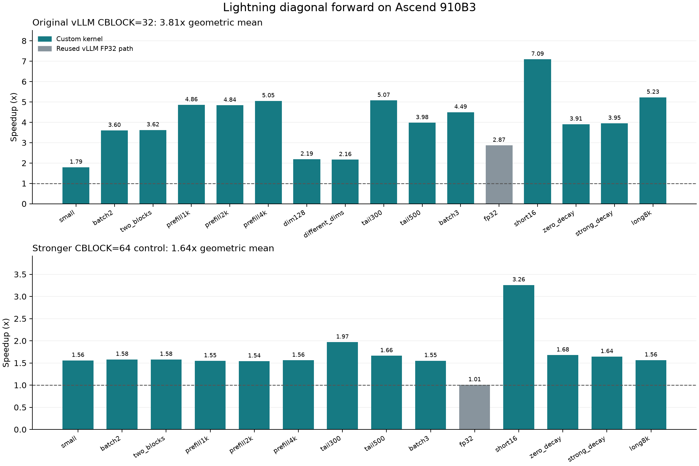

# Lightning 对角注意力：验证与性能报告

测量日期：2026-11-23（北京时间）。设备：单张 Ascend 910B3。

最终默认入口在 16 组固定自建工作负载上全部通过精度检查。相对原始 vLLM 32 分块内核，几何平均加速 **3.81×**，范围 **1.79–7.09×**。

对 14 组 D=E=64 工作负载，进一步与同一原版内核的 64 分块控制组比较，几何平均为 **1.64×**。其中 13 组自研 BF16 路径的几何平均为 **1.71×**。FP32 完整块路径复用未修改的 vLLM 64 分块内核，按来源单独标识。

## 环境

| 项目 | 实测值 |
| --- | --- |
| NPU | Ascend 910B3，20 Cube Core / 40 Vector Core |
| CANN | `/usr/local/Ascend/cann-9.2.0-beta.2` |
| 驱动 | `Version=25.5.0` |
| Python | `3.11.15` |
| torch | `2.9.0+cpu` |
| torch-npu | `2.9.0.post9` |
| triton | `3.6.0` |
| triton-ascend | `3.6.0` |
| numpy | `1.26.4` |

## 主对照：未修改的 vLLM 内核，CBLOCK=32

| 用例 | B,H,N,D,E | dtype | baseline μs | 默认入口 μs | 加速比 |
| --- | --- | --- | ---: | ---: | ---: |
| small | 1,4,256,64,64 | bfloat16 | 63.805 | 35.620 | 1.791× |
| batch2 | 2,8,256,64,64 | bfloat16 | 177.748 | 49.365 | 3.601× |
| two_blocks | 1,8,512,64,64 | bfloat16 | 179.300 | 49.484 | 3.623× |
| prefill1k | 1,16,1024,64,64 | bfloat16 | 591.990 | 121.899 | 4.856× |
| prefill2k | 1,8,2048,64,64 | bfloat16 | 591.832 | 122.395 | 4.835× |
| prefill4k | 1,8,4096,64,64 | bfloat16 | 1167.407 | 231.159 | 5.050× |
| dim128 | 1,4,512,128,128 | bfloat16 | 88.275 | 40.376 | 2.186× |
| different_dims | 1,8,512,64,128 | bfloat16 | 160.745 | 74.254 | 2.165× |
| tail300 | 1,8,300,64,64 | bfloat16 | 159.603 | 31.465 | 5.072× |
| tail500 | 1,4,500,64,64 | bfloat16 | 87.768 | 22.060 | 3.979× |
| batch3 | 3,8,256,64,64 | bfloat16 | 232.948 | 51.831 | 4.494× |
| fp32（原版64路径） | 1,8,1024,64,64 | float32 | 152.914 | 53.332 | 2.867× |
| short16 | 1,4,16,64,64 | bfloat16 | 50.514 | 7.121 | 7.094× |
| zero_decay | 1,4,512,64,64 | bfloat16 | 87.849 | 22.488 | 3.907× |
| strong_decay | 1,4,512,64,64 | bfloat16 | 87.772 | 22.234 | 3.948× |
| long8k | 1,16,8192,64,64 | bfloat16 | 4614.379 | 883.062 | 5.225× |

## 更强控制组：同一原版内核，CBLOCK=64

该组选取 D=E=64 的 14 个用例；主对照中的其余用例仍完整保留在上表。

| 用例 | 原版64 μs | 默认入口 μs | 加速比 |
| --- | ---: | ---: | ---: |
| small | 23.705 | 15.225 | 1.557× |
| batch2 | 59.311 | 37.534 | 1.580× |
| two_blocks | 59.282 | 37.539 | 1.579× |
| prefill1k | 187.875 | 121.479 | 1.547× |
| prefill2k | 187.620 | 121.699 | 1.542× |
| prefill4k | 358.587 | 229.936 | 1.560× |
| tail300 | 58.949 | 29.939 | 1.969× |
| tail500 | 37.114 | 22.336 | 1.662× |
| batch3 | 80.521 | 51.901 | 1.551× |
| fp32 | 53.576 | 53.275 | 1.006× |
| short16 | 23.498 | 7.211 | 3.259× |
| zero_decay | 37.094 | 22.113 | 1.678× |
| strong_decay | 36.884 | 22.454 | 1.643× |
| long8k | 1376.436 | 880.018 | 1.564× |

FP32 行调用相同的原版 64 分块内核；接近 1 的差异属于独立计时的波动。

## 尾块任务裁剪消融

两项实现保持同一精度、分块与数据加载策略，只切换 `prune_tail`。

| 用例 | 关闭裁剪 μs | 开启裁剪 μs | 关闭/开启 |
| --- | ---: | ---: | ---: |
| small | 15.235 | 15.561 | 0.979× |
| tail300 | 37.002 | 30.563 | 1.211× |
| short16 | 49.400 | 7.250 | 6.814× |

## 精度与实验约束

- 4 项独立参考/来源校验和 6 项真实 NPU 接口与边界测试全部通过，包含多个 dtype/shape 子用例。
- 接口与边界测试覆盖短序列、尾块、D≠E、空序列、FP32 抵消、因果隔离、块间隔离及图回放后输入更新。
- 精度参考是独立 NumPy FP64 公式，舍入到输出 dtype 后检查所有元素；阈值在性能实验前固定。
- BF16 使用 atol=0.03125、rtol=0.015625；FP32 使用 atol=0.002、rtol=0.0001；FP16 补充测试使用 atol=0.01、rtol=0.002。
- 计时为 NPU 图回放设备事件，不包含编译、CPU 参考、主机传输或完整模型。两实现使用相同输入及预分配输出。
- 每张图 16 次调用，每个测量点回放 4 次，7 轮 ABBA/BAAB；两侧各有 14 个原始测量点，分别取中位数。
- 主对照、控制组、尾块消融的输入 SHA-256 已逐例核对一致，当前代码与测量记录中的来源哈希一致。

## 实现贡献与取舍

1. 原生低精度输入 QK + FP32 score/PV/累加，与 V 后置加载共同控制缓冲存活期，使常见路径可使用 128 分块。
2. 仅发射有效 query tile；短序列/尾块裁剪的贡献由上面的单变量消融测量。
3. 基于 shape/dtype 的保守分派覆盖短序列与大维度；FP32 完整块复用强控制组内核。
4. 局部指数分解和更复杂矩形归并作为探索配置保留，默认版本采用实测更合适的路径。

早期探索记录表明：原版直接改为 128 分块，以及自研 128 分块提前加载 V 的负对照，会超出本机 192 KiB UB；双 BF16 PV 原型的 FP32 输出最大绝对误差约为 0.453，相对 L2 误差约为 0.00168。默认路径因此保持 FP32 PV 并后置加载 V。相关诊断保存在原始记录中，数学公式的来源与许可见上级说明。

## 原始记录与复现

- [主对照](20261123-release.json)
- [64 分块控制组](20261123-release-control64.json)
- [尾块消融](20261123-release-tail-ablation.json)
- [真实 NPU 接口与边界测试日志](20261123-hardware-tests-release.log)
- [数值路径探针](20261123-precision-probe.json)
- [探索阶段缓冲/尾块消融](20261123-ablation-r04.json)
- [汇总数据与来源哈希](summary.json)

运行方式见 [算子说明](../README.md)，报告可使用 `python3.11 -m operators.lightning_diag.summarize --help` 重新生成。

