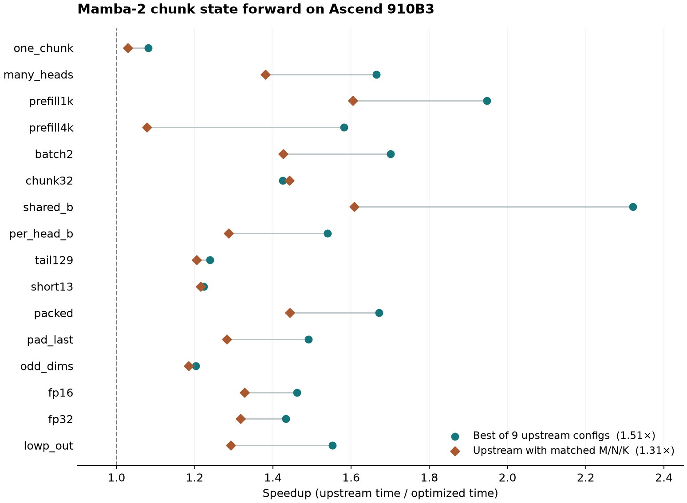

# Mamba-2 分块状态前向验证与性能报告

2026-11-23，单张 Ascend910B3。16 个固定自建用例全部通过精度验证。相对上游 9 组选型中的逐例最快配置，几何平均加速 **1.51×**（1.08–2.32×）。让上游使用与优化版相同的 M/N/K 后，16 例的几何平均加速为 **1.31×**（1.03–1.61×）。

## 逐例耗时

形状依次为 batch、序列长度、head 数、共享系数组数、head 维度、状态维度、chunk size。每一对耗时的单位均为微秒，左侧是对应的上游内核，右侧是同轮实测的优化内核。

| 用例 | 形状 | 输入→输出 | 上游最快 / 优化 | 加速 | 上游同分块 / 优化 | 加速 |
| --- | --- | --- | ---: | ---: | ---: | ---: |
| one_chunk | 1,64,8,2,64,64,64 | BF16→FP32 | 9.17 / 8.48 | 1.082× | 8.92 / 8.66 | 1.030× |
| many_heads | 1,256,32,4,64,64,64 | BF16→FP32 | 28.53 / 17.14 | 1.664× | 23.72 / 17.18 | 1.381× |
| prefill1k | 1,1024,16,4,64,128,128 | BF16→FP32 | 35.89 / 18.43 | 1.947× | 29.63 / 18.47 | 1.604× |
| prefill4k | 1,4096,16,4,64,128,256 | BF16→FP32 | 85.68 / 54.18 | 1.581× | 58.00 / 53.79 | 1.078× |
| batch2 | 2,512,8,2,64,128,128 | BF16→FP32 | 24.47 / 14.39 | 1.701× | 20.91 / 14.66 | 1.426× |
| chunk32 | 1,256,8,1,32,64,32 | BF16→FP32 | 16.75 / 11.75 | 1.425× | 17.07 / 11.84 | 1.442× |
| shared_b | 1,1024,32,1,64,64,128 | BF16→FP32 | 59.38 / 25.59 | 2.320× | 41.15 / 25.59 | 1.608× |
| per_head_b | 1,512,8,8,64,64,128 | BF16→FP32 | 17.70 / 11.50 | 1.539× | 14.60 / 11.34 | 1.287× |
| tail129 | 1,129,8,2,64,128,128 | BF16→FP32 | 12.54 / 10.13 | 1.239× | 11.84 / 9.83 | 1.204× |
| short13 | 1,13,8,1,32,64,128 | BF16→FP32 | 9.15 / 7.49 | 1.223× | 8.86 / 7.29 | 1.216× |
| packed | 2,300,8,2,64,64,64 | BF16→FP32 | 22.57 / 13.50 | 1.672× | 19.63 / 13.60 | 1.443× |
| pad_last | 1,513,8,4,64,64,128 | BF16→FP32 | 18.00 / 12.07 | 1.490× | 15.26 / 11.90 | 1.282× |
| odd_dims | 1,97,6,2,40,48,48 | BF16→FP32 | 12.51 / 10.40 | 1.203× | 12.04 / 10.16 | 1.185× |
| fp16 | 1,512,8,2,64,128,128 | FP16→FP32 | 17.85 / 12.21 | 1.462× | 15.98 / 12.03 | 1.328× |
| fp32 | 1,256,8,4,64,64,64 | FP32→FP32 | 15.65 / 10.92 | 1.433× | 14.41 / 10.94 | 1.317× |
| lowp_out | 1,511,8,2,64,64,128 | BF16→BF16 | 17.75 / 11.44 | 1.552× | 15.18 / 11.75 | 1.292× |

## 单变量消融

同一输入、同一默认实现，逐项切换一个开关。比值大于 1 表示默认路径更快。

| 对照设置 | 用例 | 对照 µs | 默认 µs | 对照 / 默认 |
| --- | --- | ---: | ---: | ---: |
| token 归约宽度固定为 32 | prefill1k | 31.74 | 19.07 | 1.664× |
| token 归约宽度固定为 32 | prefill4k | 132.92 | 54.51 | 2.438× |
| token 归约宽度固定为 32 | shared_b | 41.63 | 26.00 | 1.601× |
| 同组 head 各自加载 B | many_heads | 17.44 | 17.65 | 0.988× |
| 同组 head 各自加载 B | shared_b | 26.24 | 26.05 | 1.007× |
| 完整块保留边界掩码 | many_heads | 17.63 | 17.62 | 1.001× |
| 完整块保留边界掩码 | prefill1k | 18.60 | 18.88 | 0.985× |
| 完整块保留边界掩码 | prefill4k | 54.48 | 54.90 | 0.992× |
| 多块输入额外判断单 token 尾块 | tail129 | 12.98 | 10.06 | 1.290× |
| 多块输入额外判断单 token 尾块 | pad_last | 15.87 | 12.00 | 1.323× |
| 多块输入额外判断单 token 尾块 | odd_dims | 11.59 | 10.28 | 1.127× |

在 3 个长归约用例中，放宽 token 归约分块贡献了 1.60–2.44×。在 3 个不整齐的输入上，省去额外的单 token 尾块分支，得到 1.13–1.32×。前者改变每次矩阵乘覆盖的 token 数，后者保持计算公式和矩阵分块一致。

同组 head 复用 B 在两个用例上为 0.99–1.01×，完整块省略边界判断在三个用例上为 0.99–1.00×。这两项在所测形状上的独立效果接近持平。

## 数值与测量口径

两侧均逐元素比对独立 NumPy FP64 参考。参考保留加权 B 在点积前的 dtype 舍入，并在最终输出 dtype 上比较。优化版还与本轮上游输出逐元素比较。每次检验用 NaN 填充输出、重复执行并检查全部写入、确定性与输入哈希。

| 输入→输出 | 用例数 | 最大绝对误差 | 最大相对 L2 误差（逐例） |
| --- | ---: | ---: | ---: |
| BF16→FP32 | 13 | 0.00082016 | 1.27836e-05 |
| FP16→FP32 | 1 | 0.00022459 | 4.04503e-06 |
| FP32→FP32 | 1 | 4.76837e-07 | 7.36128e-08 |
| BF16→BF16 | 1 | 0 | 0 |

4 项 CPU 参考/来源测试与 6 项真实 NPU 接口测试通过。覆盖不对齐形状、混合类型、空序列、重复标识、负末标识、独立设置的补齐前缀终点、图回放后的输入更新，以及非连续输出写回时相邻存储的完整性。

实测环境使用 CANN `cann-9.2.0-beta.2`、驱动 `25.5.0`、Python 3.11.15、PyTorch 2.9.0+cpu、TorchNPU 2.9.0.post9、Triton-Ascend 3.6.0。

上游配置调优使用单独的随机种子，每例实测 9 组配置，共 144 组，每组取 5 次设备图测量的中位数。正式验证使用另一批固定输入；两组上游对照和消融逐例核对输入哈希及代码版本。

单算子设备计时使用预分配输出。每张图包含 16 次真实调用，每个测量点回放 4 次，执行 7 轮 ABBA/BAAB，两侧各取 14 个测量点的中位数再计算比值。编译、参考计算、输入传输和完整模型推理在计时范围之外。

## 复现材料

- [分块状态数学定义与运行命令](../README.md)
- [144 组上游调优记录](upstream-configs.json)
- [上游逐例最快配置的成对计时](primary.json)
- [上游同分块的成对计时](same-tiles.json)
- [硬件与接口测试日志](hardware-tests.log)
- [归约分块消融](ablation-reduction.json) · [共享读取消融](ablation-heads.json) · [边界掩码消融](ablation-masks.json) · [尾块分支消融](ablation-tail.json)
- [机器可读汇总](summary.json)
