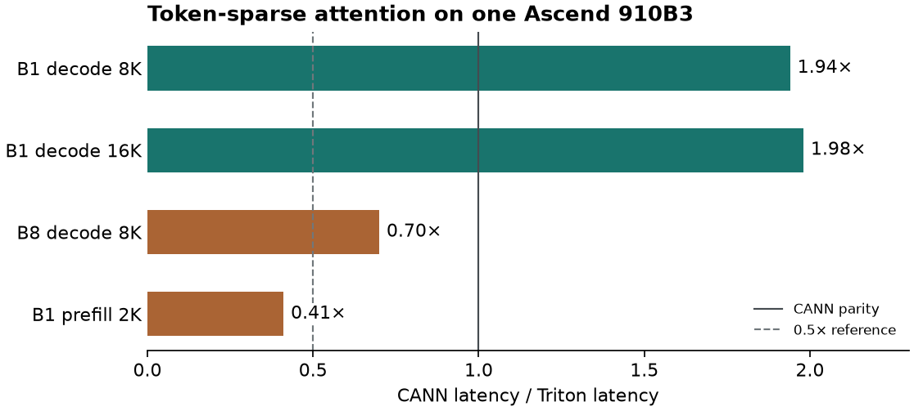

# 稀疏 Flash 注意力前向实测

单张 Ascend 910B3 上，两组公开算例相对原版 PyTorch FP32 参考的几何平均加速为 **8.44×**。四组 CANN 原生对照中，单条 8K、16K decode 分别达到 **1.94×、1.98×**，batch=8 和 2K prefill 分别为 **0.70×、0.41×**。

## CANN 原生对照

双方传入相同的 BF16 张量、逐 token 索引和缩放，K/V 共享存储。四组均为 128 个查询头、K=2048。耗时是同轮 Ascend 事件的中位数，加速比为 CANN 耗时除以本实现耗时。

| 负载 | B × Q × S | CANN µs | 本实现 µs | 相对 CANN |
| --- | --- | ---: | ---: | ---: |
| B1 decode 8K | 1 × 1 × 8192 | 97.47 | 50.22 | 1.941× |
| B1 decode 16K | 1 × 1 × 16384 | 97.38 | 49.15 | 1.981× |
| B8 decode 8K | 8 × 1 × 8192 | 102.77 | 146.71 | 0.701× |
| B1 prefill 2K | 1 × 2048 × 2048 | 8,084.39 | 19,643.06 | 0.412× |

任务书给出整体性能大于 0.5× 的目标，未指定聚合公式。四种形状等权取几何平均为 **1.026×**，其中 3/4 形状超过 0.5×。每种形状各运行一次时，两侧耗时分别求和再相除为 **0.421×**，2K prefill 占据主要时间。两种口径均列出供评审采用。[任务书](../third_party/public_examples/task.md) · [原始 CANN 计时](native.json)

## 公开 FP32 参考与独立 V

16 个任务书形状全部通过。可以整段运行原参考的 15 个形状，几何平均加速 **11.76×**。2K prefill 的原参考曾在该卡一次申请 54 GiB 并触发 OOM。该行沿 Q 每 32 行调用未经修改的参考函数，组合出完整输出，计时包含各次调用和结果写回。另列 1 个含重复、越界和全无效行的压力用例。[公开源码与版本](../third_party/source.json) · [逐例原始记录](public.json) · [显存诊断](prefill-reference.log)

| 用例 | B / Q / S / H / K | dtype | 参考 µs | 本实现 µs | 加速 | 最大绝对误差 |
| --- | --- | --- | ---: | ---: | ---: | ---: |
| sfa-001 | 1 / 1 / 2048 / 128 / 2048 | BF16 | 413.51 | 50.16 | 8.24× | 0.000488281 |
| sfa-002 | 1 / 1 / 4096 / 128 / 2048 | BF16 | 433.42 | 50.13 | 8.65× | 0.000244141 |
| decode8k | 1 / 1 / 8192 / 128 / 2048 | BF16 | 476.38 | 50.57 | 9.42× | 0.000244141 |
| decode16k | 1 / 1 / 16384 / 128 / 2048 | BF16 | 564.51 | 51.25 | 11.01× | 0.000244141 |
| decode_batch8 | 8 / 1 / 8192 / 128 / 2048 | BF16 | 2,551.99 | 150.19 | 16.99× | 0.000488281 |
| prefill1k | 1 / 1024 / 1024 / 128 / 2048 | BF16 | 111,521.68 | 5,616.18 | 19.86× | 0.000976562 |
| prefill2k（参考分片） | 1 / 2048 / 2048 / 128 / 2048 | BF16 | 289,213.97 | 19,773.94 | 14.63× | 0.000976562 |
| decode_batch4 | 4 / 1 / 1024 / 128 / 2048 | BF16 | 719.28 | 102.42 | 7.02× | 0.000488281 |
| heads8 | 1 / 1 / 8192 / 8 / 2048 | BF16 | 429.42 | 40.57 | 10.58× | 0.00012207 |
| heads32 | 1 / 1 / 8192 / 32 / 2048 | BF16 | 456.20 | 36.98 | 12.33× | 0.000488281 |
| heads64 | 1 / 1 / 8192 / 64 / 2048 | BF16 | 473.59 | 39.82 | 11.89× | 6.10352e-05 |
| k256 | 1 / 1 / 512 / 128 / 256 | BF16 | 316.47 | 27.36 | 11.57× | 0.000488281 |
| k512 | 1 / 1 / 8192 / 128 / 512 | BF16 | 457.65 | 31.26 | 14.64× | 0.000976562 |
| odd_q37 | 1 / 37 / 1000 / 16 / 128 | BF16 | 1,045.30 | 33.40 | 31.29× | 0.00195312 |
| batch5 | 5 / 1 / 1024 / 128 / 2048 | BF16 | 856.92 | 106.46 | 8.05× | 0.000488281 |
| fp16_8k | 1 / 1 / 8192 / 128 / 2048 | FP16 | 479.19 | 48.87 | 9.81× | 6.10352e-05 |
| mixed_indices | 2 / 7 / 193 / 8 / 97 | BF16 | 607.19 | 57.44 | 10.57× | 0.00195312 |

## 调度与消融

同一组独立 V 输入、相同计时协议，只替换表内的执行路径。窄分块为 32 头 × 64 个 token，宽分块为 64 × 128，大分块为 128 × 256。

| 用例 | 对照 → 默认 | 对照 µs | 默认 µs | 对照 / 默认 |
| --- | --- | ---: | ---: | ---: |
| decode8k | `pack_wide` → `gather_wide` | 49.28 | 49.58 | 0.994× |
| decode16k | `pack_wide` → `gather_wide` | 49.23 | 49.17 | 1.001× |
| decode_batch8 | `pack_wide` → `pack_large` | 179.79 | 147.23 | 1.221× |
| odd_q37 | `pack_wide` → `one_tile` | 55.99 | 33.39 | 1.677× |
| prefill1k | `pack_large` → `counts_large` | 59,685.64 | 5,491.05 | 10.870× |
| prefill2k | `pack_large` → `counts_large` | 37,762.94 | 19,628.86 | 1.924× |
| decode_batch8 | `pack_narrow` → `pack_large` | 631.90 | 146.33 | 4.318× |
| prefill1k | `counts_single` → `counts_large` | 7,436.24 | 5,477.39 | 1.358× |
| prefill2k | `counts_single` → `counts_large` | 23,965.83 | 19,677.53 | 1.218× |

`gather_wide` 在 QK 内读取 K/RoPE 并一次打包 V。`pack_*` 预先打包三份张量。`counts_large` 用每行下标频次访问物理 KV，长 prefill 每 8 个头共读一份频次。`counts_single` 保持相同的物理遍历和 Cube 分块，每次只归一化一个头。`one_tile` 将短索引归约留在片上。两项单条 decode 对照保持相同分块，短索引一行比较两条完整路径。prefill 的打包对照包括遍历方式和归一化两项差异，另用 `counts_single` 隔离跨头归一化的贡献。各项耗时都来自各自独立的成对运行。[打包与短索引](ablation-pack.json) · [物理顺序与出现次数](ablation-counts.json) · [矩阵分块](ablation-tiles.json) · [跨头归一化](ablation-softmax.json)

2K prefill 中，物理顺序遍历加跨头归一化比集中打包快 1.92×。仅切换归一化的头数，1K 和 2K 分别快 1.36× 和 1.22×。单条 8K 与 16K decode 的两种打包方式耗时接近，融合读取时每次调用所需的显式临时张量由 5.25 MiB 降至 3.00 MiB（按张量形状和 dtype 计算）。

## 精度与计时方法

- 独立 V 的 17 组共检查 **203,313,152** 个输出元素。公开容差为 atol=rtol=0.05、匹配率至少 99.5%。本次还要求每个元素满足 BF16 的 atol=rtol=0.008 或 FP16 的 0.002，最大绝对误差为 **0.00195312**。每组复算一次，输出逐位一致，输入 SHA-256 前后一致。
- 独立 CPU FP64 实现逐行过滤索引并保留重复项，对所选 batch、query、head 的全部 512 个通道做交叉校验。用本实现对真值的误差除以公开参考对同一真值的误差，17 个用例中最大的 MARE、MERE、RMSE 三项比值分别为 1.000000、1.000269、1.000002。L1 正常值域对应的三项限值为 5、1.5、1.5。这里报告单卡抽样指标，商业 L1 认证还涉及多平台与更大测试规模。[CANN 精度标准](https://gitcode.com/cann/opbase/blob/c260c8ab7a9be4823ac8f8a07c60442de9bf141e/docs/zh/ops_precision_standard/commercial_standard.md)
- 14 项自动化测试覆盖来源文件、BF16/FP16、1/2/4 头、重复与无效索引、独立及共享 V、负缩放、非零存储偏移、图重放时变更索引等。[测试日志](hardware-tests.log)
- 预热 5 次再计时。decode 及短用例每张图捕获 6 次调用，先重放预热 2 次，每次计时重放 3 次，交替 ABBA/BAAB 共 7 轮。大 prefill 的公开参考使用 eager 事件、单次调用、3 轮；大 prefill 的原生与消融对照使用各捕获 1 次调用的图、每次重放 1 次、5 轮。每轮每侧计时两次。两侧采用同一协议，计时涵盖算子调用的全部设备工作，编译、输入生成、主机校验和传输另计。
- 测量日期 2026-11-23，设备 Ascend910B3 物理卡 1。软件为 cann-9.2.0-beta.2、Triton-Ascend 3.6.0、Python 3.11.15、torch 2.9.0+cpu 和 torch-npu 2.9.0.post9。驱动版本、输入及代码 SHA-256 随原始记录保存。耗时覆盖本前向算子。[复现命令](../README.md) · [机器可读摘要](summary.json)
